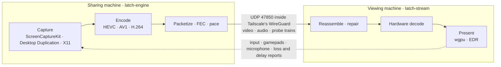

<div align="center">

<picture>
  <source media="(prefers-color-scheme: dark)" srcset="docs/brand/logo-dark.svg">
  
</picture>

# Latch

**Your machines, on any of your machines.**

Low-latency desktop and game streaming between computers you own, over
[Tailscale](https://tailscale.com). One app for macOS, Windows and Linux,
written in Rust.

[](https://github.com/MrBeldum/latch/actions/workflows/ci.yml)
[](https://github.com/MrBeldum/latch/releases/latest)
[](https://github.com/MrBeldum/latch/releases)
[](LICENSE)

[Website](https://mrbeldum.github.io/latch/) ·
[Download](https://github.com/MrBeldum/latch/releases/latest) ·
[Documentation](docs/README.md) ·
[Changelog](CHANGELOG.md) ·
[Discussions](https://github.com/MrBeldum/latch/discussions)

<br>


</div>

## What it is

Install Latch on your computers and sign them in to the same Tailscale
account. Each one lists the others. Click **Connect** and the other
machine's desktop appears full screen, with its sound, your keyboard, mouse
and gamepads, and the clipboard. Every install can both view and share;
there is no separate host and client to pick.

- **Fast.** Hardware HEVC, AV1 and H.264, HDR10 and ten-bit colour, 5.1 and
  7.1 sound. Latch sets no ceilings of its own: a stream asks for this
  display's own size and refresh rate (anything up to 16384 pixels a side,
  500 fps and 1 Gbps) and the two machines and the path between them decide
  what you get. [Measured numbers](docs/PERFORMANCE.md).
- **Nothing to configure.** No accounts, no pairing PINs, no port
  forwarding. Tailscale is the identity check and the encryption; Latch
  answers only devices signed in to your own account.
- **Holds up on a bad network.** Reed–Solomon forward error correction
  rebuilds lost packets instead of waiting for them, a delay-based
  congestion controller spends parity before it spends bitrate, and a frame
  that is lost anyway costs a small recovery frame where the encoder can
  make one.
- **Made for games.** Captured raw mouse, Xbox and DualShock pads with
  rumble, a stats overlay with a latency breakdown, and quality profiles
  for competitive (1080p at up to 360 fps) or cinematic (4K at up to 120)
  play.
- **Reaches a sleeping PC.** Wake-on-LAN, a self-hosted relay kit for
  networks that cannot connect directly, remote sleep and restart, and
  updates that install themselves.
- **One small binary.** The whole engine is Rust, in the same executable as
  the window: no bundled streaming server, no drivers to hunt for, and no
  C, C++ or assembler anywhere in the build.

## Install

Every machine needs [Tailscale](https://tailscale.com/download), signed in
to the same account. Then:

<details open>
<summary><b>Windows 10 or 11</b> (x64)</summary>

1. Download `latch-windows-x64.zip` from the
   [latest release](https://github.com/MrBeldum/latch/releases/latest),
   unzip it and run `latch-host.exe` (or `install-host.ps1` for a Start
   menu shortcut and start at sign-in).
2. To share this PC, open the **Sharing** tab and click **Set up as
   administrator**. Windows asks once. Setup opens Latch's port to
   Tailscale addresses only, arms Wake-on-LAN and keeps the PC awake on
   mains power; `latch-host.exe --uninstall` puts everything back.

Details: [docs/WINDOWS.md](docs/WINDOWS.md).
</details>

<details open>
<summary><b>macOS 13 or later</b> (Apple Silicon)</summary>

```bash
curl -fsSL https://raw.githubusercontent.com/MrBeldum/latch/main/scripts/install-macos-release.sh | bash
```

The script downloads the latest release, checks it against the digest
GitHub publishes, and copies `Latch.app` to `/Applications`. To share this
Mac, open the **Sharing** tab; macOS asks for Screen Recording and
Accessibility.

The app is ad-hoc signed, not notarized, so a copy downloaded in a browser
needs `xattr -dr com.apple.quarantine Latch.app` before it opens
([why](docs/ROADMAP.md#signing-and-notarization)).
Details: [docs/MACOS.md](docs/MACOS.md).
</details>

<details open>
<summary><b>Linux</b> (x64 and arm64, X11)</summary>

Download `latch-host-linux-x64.tar.gz` or `latch-host-linux-arm64.tar.gz`
from the [latest release](https://github.com/MrBeldum/latch/releases/latest)
(built on Ubuntu 24.04; needs glibc 2.39 or later) and run `latch-host`.
For a headless server or VPS that shares a virtual desktop:

- systemd units: [deploy/native/README.md](deploy/native/README.md)
- a Docker container: [deploy/node/NODE.md](deploy/node/NODE.md)

</details>

Then open Latch on any machine and click **Connect** beside another. The
[user guide](docs/USING.md) covers the stream toolbar, waking a PC,
updates, and keeping a machine reachable when nobody is there.

## What each platform does

| | Shares its desktop with | Views with |
|---|---|---|
| **Windows** | Desktop Duplication capture; HEVC, AV1 or H.264 on the GPU (AMD through AMF directly, others through Media Foundation); HDR10; virtual gamepads (ViGEmBus) | Hardware AV1, HEVC and H.264 (DXVA); HDR |
| **macOS** | ScreenCaptureKit capture; HEVC or H.264 on VideoToolbox; HDR10 | Hardware AV1 (M3 and later), HEVC and H.264 (VideoToolbox); HDR |
| **Linux** | X11 capture of changed regions; software H.264 everywhere, NVENC and VA-API where there is a GPU; virtual gamepads (uinput) | Software H.264 |

Some of this has not yet met real hardware, and the documentation says so
wherever that is the case: Linux GPU encoding is written but untested on a
GPU, and HDR has been verified by readback, not yet on a physical HDR
panel. [docs/PERFORMANCE.md](docs/PERFORMANCE.md) lists what was measured,
on what, and how to repeat it.

## How it compares

| | Latch | Sunshine + Moonlight | Parsec | GeForce NOW |
|---|---|---|---|---|
| Streams | your own machines | your own machines | your own machines | NVIDIA's servers |
| Sign-in | your Tailscale account | PIN pairing per device | Parsec account | NVIDIA account |
| Reaching home from outside | Tailscale; no ports opened | port forwarding or your own VPN | Parsec's servers | n/a |
| Apps to install | one, the same on every machine | a host and a client | one | one |
| Viewers | macOS, Windows, Linux | nearly everything, phones and TVs included | desktops, Android, web | nearly everything |
| Source | GPL-3.0, all Rust | GPL-3.0 | closed | closed |

Latch is the youngest of these. If you need a phone, a TV or a browser as
the viewer, Moonlight is the one to use today.

## How it works



A stream starts with an HTTP upgrade on TCP 47850 that the Tailscale
identity check admits, then runs over UDP on the same port. Video and
lossless audio (`lpcm-rice`) go one way; input, gamepads, an optional
microphone and receiver reports go the other. The sender's controller
reads delay and loss from those reports and steers the encoder's bitrate,
the FEC share and the pacing.

- [docs/ENGINE.md](docs/ENGINE.md): the design, stage by stage, and why
- [docs/PROTOCOL.md](docs/PROTOCOL.md): the wire format

## Security

- The control service and the stream answer only loopback and Tailscale
  addresses that `tailscale whois` puts on the account this machine is
  signed in to. Nodes shared in from other tailnets get a 403.
- The stream is encrypted by Tailscale's WireGuard. There is no Latch
  account, password or pairing secret to leak.
- The firewall rules Windows setup adds are scoped to Tailscale's address
  ranges.
- Updates are checked against the digest GitHub publishes for the release.

The full model, and how to report a problem privately, is in
[SECURITY.md](SECURITY.md).

## Building from source

Rust stable and the platform's linker are all it takes (Visual Studio
Build Tools on Windows, the Xcode command line tools on a Mac, and on
Linux the `-dev` packages listed in [CONTRIBUTING.md](CONTRIBUTING.md)).
There is no C toolchain, CMake or vendored library to set up.

```bash
cargo run --release -p latch-host        # the app
cargo test --workspace                   # the tests
./scripts/install-macos.sh               # macOS: build, bundle and install Latch.app
```

```
crates/core     control API, small HTTP, Tailscale CLI, wake packets, config
crates/proto    wire format, FEC, packetizer and reassembler, input reliability
crates/codec    software H.264 encoder and decoder, lpcm-rice audio
crates/engine   sharing side: capture, encode, transport, audio capture, input
crates/stream   viewing side: session, decoders, audio playback
crates/client   viewer UI: machine list, stream window, toolbar, presenter
crates/host     the app: control service, setup, the unified window
crates/ui       theme and widgets
deploy/         Docker node, systemd units, and the relay kit
```

## Contributing

Issues, measurements from hardware we do not have, and pull requests are
all welcome. [CONTRIBUTING.md](CONTRIBUTING.md) explains how the code is
laid out, how to see every screen without a second machine, and what a
pull request needs. Good places to start are labelled
[good first issue](https://github.com/MrBeldum/latch/labels/good%20first%20issue)
and [help wanted](https://github.com/MrBeldum/latch/labels/help%20wanted);
[docs/ROADMAP.md](docs/ROADMAP.md) says where the project is going.
Everyone taking part is expected to follow the
[code of conduct](CODE_OF_CONDUCT.md).

## License

GPL-3.0-or-later; see [LICENSE](LICENSE). Parts of the H.264 decoder are
adapted from pith-h264 (MIT). Third-party notices, fonts included, are in
[NOTICE](NOTICE).

Latch is an independent project. It is not affiliated with Tailscale,
NVIDIA, Parsec or the Sunshine and Moonlight projects; their names are
used only to describe what Latch works with or compares to.
